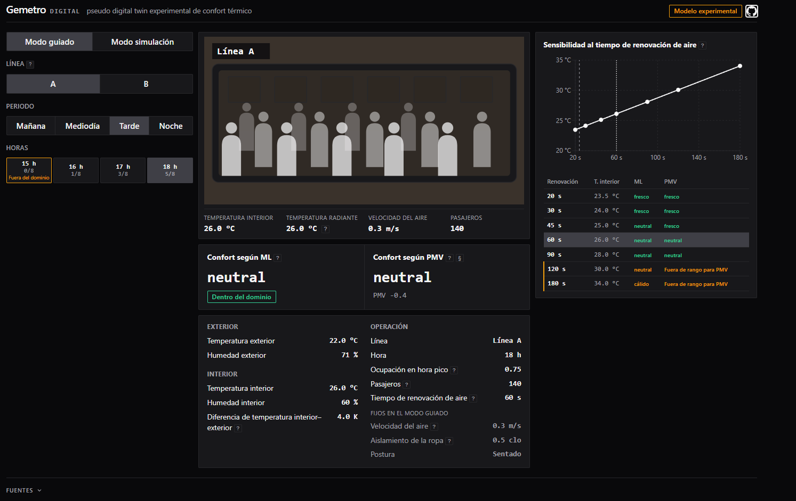

# Gemetro Digital

Gemetro Digital es un pseudo gemelo digital que estima el nivel de comodidad de los pasajeros de un vagón de metro dependiendo del clima, la ocupación y la ventilación. Se trata de un proyecto exploratorio puesto que su objetivo es investigar qué tan lejos se puede llegar usando modelos de machine learning con datos abiertos, con el Metro de Medellín como caso de estudio.

El proyecto se divide en tres pilares principales:

- **Componente físico:** un modelo físico de balance de energía y humedad que calcula la temperatura y humedad dentro del vagón partiendo desde el clima exterior, el calor y el vapor que emiten los pasajeros y la renovación del aire 
- **Componente de machine learning:** un modelo de machine learning entrenado con [encuestas reales de pasajeros](#ref-1)
- **Componente referencial:**  el índice PMV de la [norma ISO 7730](#ref-4), la fórmula clásica de confort térmico, que se usa como punto de comparación para medir si el machine learning mejora lo que ya existe

<br>

<p align="center">
  <a href="https://gemetro-digital.vercel.app"><strong>Ver la demo →</strong></a>
</p>

<p align="center">
  
</p>

> La primera carga puede tardar cerca de un minuto mientras la API se activa.

<br>

<p align="center">
  <a href="https://www.python.org/"></a>
  <a href="https://fastapi.tiangolo.com/"></a>
  <a href="https://scikit-learn.org/"></a>
  <a href="https://pandas.pydata.org/"></a>
  <a href="https://react.dev/"></a>
  <a href="https://vite.dev/"></a>
  <a href="https://vitest.dev/"></a>
  <a href="https://recharts.org/"></a>
  <a href="https://www.docker.com/"></a>
  <a href="https://render.com/"></a>
  <a href="https://vercel.com/"></a>
</p>

## Qué se puede hacer

- Elegir línea, hora del día, nivel de ocupación y ventilación, y ver la temperatura y humedad estimadas dentro del vagón.
- Ver cómo se sentirían los pasajeros en esas condiciones (fresco, neutral o cálido) según el modelo de machine learning y según el PMV, uno al lado del otro.
- Ver cuánto cambia el resultado si la ventilación es mejor o peor, que es el dato más incierto del escenario.
- Recorrer un día típico en el modo guiado, o ajustar cada parámetro a mano en el modo simulación.

Sobre las encuestas reales de Nanjing, el modelo de machine learning acierta más que el PMV: 0.389 contra 0.299 de F1 macro, con mejora en los cinco días evaluados. Los valores absolutos son bajos por las limitaciones de los datos disponibles, como se explica en [Resultados](#resultados).

## Cómo funciona

```text
Clima IDEAM (Tout, RH_out) ─┐
Afluencia + GTFS → N        ─┼─► modelo físico ─► Tin, RH_in ─┬─► machine learning ─► fresco / neutral / cálido
Ventilación τr (escenario)  ─┘                               └─► PMV ISO 7730     ─► fresco / neutral / cálido
```

1. Se toma el clima exterior de la hora elegida (IDEAM, 2025) y se calcula cuántos pasajeros van en el vagón a partir de la afluencia y los horarios del Metro.
2. El modelo físico calcula la temperatura y la humedad dentro del vagón con esos datos y con la ventilación del escenario.
3. Con esas condiciones, el modelo de machine learning y el PMV clasifican por separado la sensación térmica en fresco, neutral o cálido.
4. El mismo cálculo se repite con ocho niveles de ventilación, para ver cuánto depende el resultado de ese dato.

Origen de cada dato:

| Tipo | Qué incluye |
| --- | --- |
| Datos reales | Clima IDEAM, afluencia y horarios del Metro (2025), encuestas en vagones de Nanjing |
| Supuestos del escenario | Capacidad y volumen del vagón, ventilación, ropa, velocidad del aire, postura |
| Calculado | Temperatura y humedad dentro del vagón |
| Predicho | Sensación térmica (machine learning y PMV) |

## Resultados

El modelo de machine learning se comparó con el PMV sobre 608 respuestas reales de las encuestas de Nanjing, las que caen dentro del rango en que la norma ISO 7730 permite calcular el PMV.

| Métrica | Machine learning | PMV |
| --- | --- | --- |
| F1 macro | 0.389 | 0.299 |
| Accuracy balanceada | 0.402 | 0.364 |
| Errores opuestos (fresco ↔ cálido) | 44 | 50 |

La métrica principal es F1 macro porque el 67 % de las respuestas son "neutral". Un modelo que siempre dijera "neutral" acertaría el 67 % de las veces, pero su F1 macro sería de 0.27, porque nunca detectaría el frío ni el calor.

El modelo final es una regresión logística. Se probaron también random forest y gradient boosting; rindieron prácticamente igual, así que se eligió el más simple de interpretar.

### Interpretación de los resultados

Los valores son bajos por falta de datos adecuados, no por el método:

- El modelo se entrenó con 882 encuestas de cinco días en otra ciudad, en vagones con aire acondicionado.
- Solo recibe cinco variables del ambiente: temperatura, humedad, velocidad del aire, ropa y postura. No recibe información sobre cada pasajero, como su aclimatación o actividad previa.
- Cambiar de algoritmo no movió el resultado: regresión logística, random forest y gradient boosting rindieron casi igual. Agregar datos de otros estudios (ASHRAE) tampoco lo mejoró de forma clara.
- El PMV acierta el 37 % de las sensaciones en estos datos, en línea con el 34 % que reporta la ASHRAE Global Thermal Comfort Database II ([Cheung et al., 2019](https://doi.org/10.1016/j.buildenv.2019.01.055)). Con los datos disponibles, ninguna de las dos aproximaciones llega lejos.

Aun así, el machine learning mejora al PMV en los cinco días evaluados, con una diferencia de +0.090 en F1 macro (intervalo de confianza del 95 %: +0.035 a +0.145). Cada día se evaluó con un modelo entrenado sin ese día, y la configuración de la evaluación se fijó antes de ver resultados.

El proyecto deja lista la cadena completa (modelo físico, entrenamiento y evaluación contra el PMV) para repetir el análisis si existieran mediciones y encuestas en vagones de Medellín.

El detalle de cada experimento está en `reports/evaluation/`.

## Inicio rápido

La aplicación funciona con los archivos incluidos en el repositorio; no hace falta descargar datos.

Con Docker:

```bash
docker compose up --build    # API en :8000, frontend en http://localhost:5500
```

Sin Docker (Python 3.12 y Node.js):

```bash
python -m venv .venv
.venv/Scripts/python.exe -m pip install -r requirements-dev.txt -e .   # Linux/macOS: .venv/bin/python
GEMETRO_ALLOWED_ORIGINS=http://localhost:5500 python -m uvicorn gemetro.api:app --port 8000
```

```bash
cd frontend
npm install
npm run dev                  # http://localhost:5500
```

## Arquitectura

| Módulo (`src/gemetro/`) | Qué hace |
| --- | --- |
| `simulator.py` | Modelo físico: temperatura y humedad dentro del vagón |
| `pmv.py` | Cálculo del PMV según ISO 7730 |
| `comfort_model.py` | Predicción del modelo de machine learning; avisa cuando las condiciones salen del rango de entrenamiento |
| `occupancy.py` | Pasajeros por hora a partir de la afluencia |
| `scenario.py` | Arma cada escenario y repite el cálculo para los distintos niveles de ventilación |
| `guided.py` | Escenarios del modo guiado |
| `api.py` | API con FastAPI |
| `data/` | Descarga y preparación de los datos |
| `evaluation/`, `experiments/` | Entrenamiento, evaluación y experimentos |

El frontend (`frontend/`) está hecho con React y Vite.

API:

| Endpoint | Qué hace |
| --- | --- |
| `GET /health` | Estado del servicio |
| `GET /config` | Parámetros disponibles y rango del modelo |
| `GET /guided?line=A\|B&period=morning\|midday\|afternoon\|night` | Escenarios del modo guiado |
| `POST /scenario` | Calcula un escenario y devuelve el resultado del machine learning y del PMV |

Variables de entorno:

| Variable | Dónde | Descripción |
| --- | --- | --- |
| `GEMETRO_ALLOWED_ORIGINS` | API | Orígenes CORS permitidos, separados por coma |
| `VITE_API_URL` | Frontend | URL de la API (por defecto `http://localhost:8000`) |

## Reproducir el entrenamiento

Las encuestas de Nanjing no se incluyen en el repositorio. Se descargan desde el enlace del estudio original (ver [Fuentes](#fuentes)) y se ubican en `data/raw/Data/Data/`. Después:

```bash
python -m gemetro.data.medellin_download              # descarga los datos públicos de Medellín
python -m gemetro.data.climate                        # clima horario 2025
python -m gemetro.data.occupancy_shape                # pasajeros por hora
python -m gemetro.experiments.e01_nanjing_final_set   # limpieza de las encuestas
python -m gemetro.experiments.e02_ml_vs_pmv           # comparación machine learning vs PMV (~6 min)
python -m gemetro.experiments.e03_final_model         # modelo final
```

Los intentos de mejora están en `e04_*`, `e05_*` y `e06_*`. El último necesita además la ASHRAE Global Thermal Comfort Database II en `data/raw/`.

Cada paso comprueba que los datos de entrada no cambiaron; con los mismos datos, los resultados son idénticos.

## Pruebas

```bash
python -m pytest -q                       # backend (no necesita datos)
cd frontend && npm test                   # frontend
GEMETRO_E2E_API=http://localhost:8000 npm test -- tests/e2e.test.js   # extremo a extremo, con la API corriendo
```

## Limitaciones

Todos los datos del proyecto son externos: clima y afluencia públicos de Medellín y encuestas de Nanjing. No hay mediciones dentro de vagones de Medellín, así que los resultados para Medellín son escenarios calculados y no se pudieron comparar con la realidad. Las limitaciones principales son:

- Las encuestas de Nanjing se hicieron en vagones con aire acondicionado, y el escenario de Medellín es un vagón sin él. Cuando las condiciones salen del rango de las encuestas, la aplicación lo indica.
- La ventilación real del vagón no se conoce, por eso se muestran varios niveles en vez de uno solo.
- La cantidad de pasajeros se estima a partir de la afluencia y una capacidad de referencia; no es un conteo real.
- En cerca del 24 % de las encuestas de Nanjing las condiciones salen del rango en que la norma permite calcular el PMV, y esas respuestas no entran en la comparación.

## Roadmap

**Fase 0 — Viabilidad.** La idea inicial era un gemelo digital que optimizara el balance entre confort y energía, apoyado en SEED, un dataset de una estación de metro. Esa idea se descartó por tres razones: los archivos de SEED ya no están accesibles, SEED describe una estación subterránea con aire acondicionado, y los vagones de las líneas A y B no tienen aire acondicionado. Después de evaluar otras combinaciones de datos, el proyecto quedó como un simulador de escenarios: datos públicos de Medellín, un modelo físico del vagón y un modelo de confort entrenado con encuestas de Nanjing, comparado contra el PMV. El control y la optimización quedaron fuera del alcance.

**Fase 1 — Arquitectura.** Definición de los componentes, el contrato de la API y el protocolo de evaluación del machine learning contra el PMV, fijado antes de entrenar.

**Fase 2 — Implementación y validación.** Descarga y limpieza de datos, modelo físico, PMV y entrenamiento del modelo de confort. Se compararon el machine learning y el PMV, y se probaron tres variantes para mejorar el modelo; ninguna dio una mejora clara, así que se mantuvo el modelo original.

**Aplicación web.** API con FastAPI y frontend en React, con un modo guiado que recorre un día típico y un modo simulación, desplegados en Render y Vercel.

## Estructura del repositorio

| Ruta | Contenido |
| --- | --- |
| `src/gemetro/` | Código Python: datos, modelo físico, PMV, machine learning y API |
| `frontend/` | Aplicación web |
| `config/evaluation.toml` | Configuración de la evaluación |
| `artifacts/` | Clima, pasajeros por hora y modelo entrenado que usa la API |
| `reports/` | Resultados de cada experimento |
| `data/manifests/` | Procedencia de los datos |
| `tests/`, `frontend/tests/` | Pruebas |

## Fuentes

1. <a id="ref-1"></a>Encuestas de confort: vagones del metro de Nanjing (junio–julio de 2025), del estudio de Zhang, Li y Chen, *Journal of Building Physics* (2026), https://doi.org/10.1177/17442591261474106. Datos publicados en https://pan.baidu.com/s/1o3wor2rxNiptwnvJ2fthag?pwd=4d84; no se incluyen en este repositorio.
2. <a id="ref-2"></a>Clima exterior: IDEAM, estación Olaya Herrera, datasets `sbwg-7ju4` y `uext-mhny` en datos.gov.co (CC BY-SA 4.0).
3. <a id="ref-3"></a>Afluencia y horarios (GTFS) 2025: Metro de Medellín, portal de datos abiertos (licencia no declarada; se cita la fuente).
4. <a id="ref-4"></a>PMV: norma ISO 7730.

Proyecto independiente, sin relación con el Metro de Medellín.
